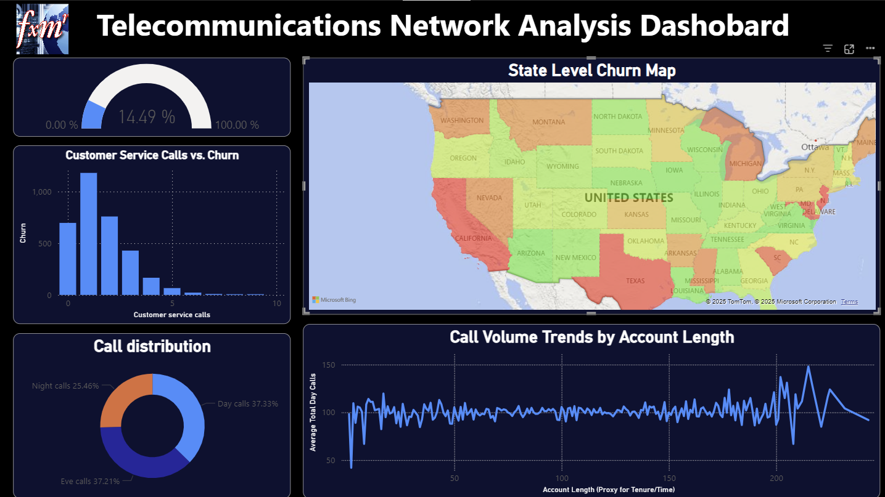
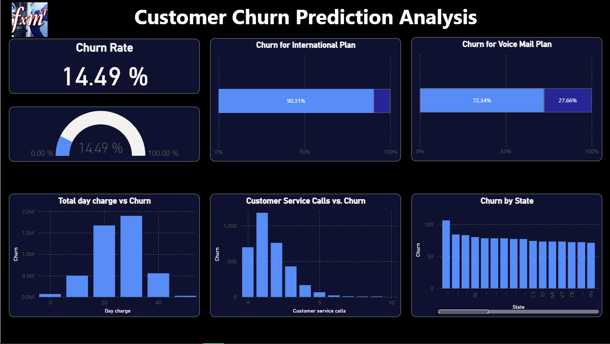
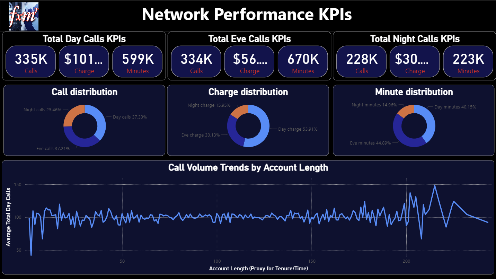
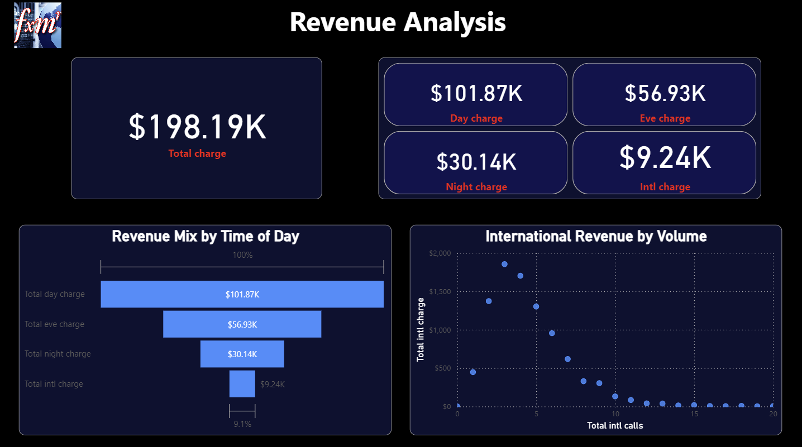
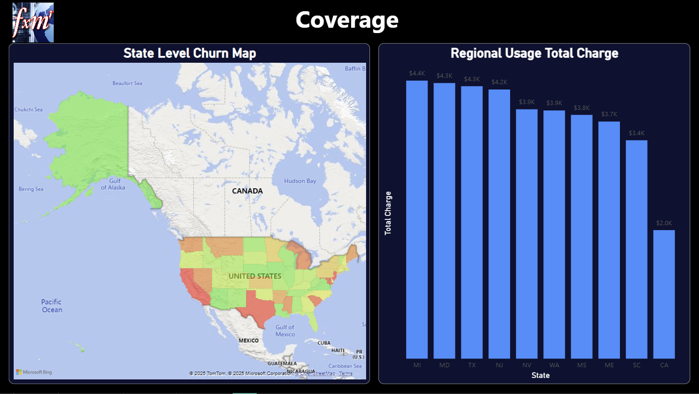

> **Portfolio Project — Skill Demonstration**
> Built on a publicly available telecommunications training dataset (3,333 customer records,
> widely used in Power BI and data analytics coursework). This is not derived from a client
> engagement. The analytical questions, KPI design, and dashboard architecture reflect 30+ years
> of direct experience in the telecom industry — these are the metrics that actually matter to
> commercial and operations leadership.

# 📡 Telecommunications Network Analysis Dashboard

[](https://powerbi.microsoft.com/)
[]()
[]()

> **Transforming telecommunications data into actionable business intelligence through comprehensive analytics and predictive insights.**



---

## 📋 Table of Contents

- [Project Overview](#-project-overview)
- [Key Features](#-key-features)
- [Dashboard Pages](#-dashboard-pages)
- [Dashboard Construction Process](#-dashboard-construction-process)
- [The Analytical Questions](#-the-analytical-questions)
- [Development Process](#-development-process)
- [Technical Outcomes](#-technical-outcomes)
- [Lessons Learned](#-lessons-learned)

---

## 🎯 Project Overview

A comprehensive **Power BI analytics solution** designed to transform raw telecommunications data into actionable insights across four critical business domains:

- 📉 **Customer Churn Prediction**
- 📊 **Network Performance Monitoring**
- 💰 **Revenue Analysis & Optimization**
- 🗺️ **Geographic Coverage Intelligence**

This multi-dimensional dashboard enables **data-driven decision-making** by providing real-time visibility into critical business metrics, customer behavior patterns, and operational efficiency indicators.

### Quick Stats

| Metric | Value |
|--------|-------|
| **Overall Churn Rate** | 14.49% |
| **Total Revenue** | $198.19K |
| **Total Calls Analyzed** | 897K+ |
| **States Covered** | 50+ |
| **Dashboard Pages** | 4 |

---

## ⚡ Key Features

- ✅ **Real-time KPI Monitoring** - Track critical metrics with live data refresh
- 🎯 **Predictive Churn Analysis** - Identify at-risk customers before they leave
- 📈 **Revenue Attribution** - Understand revenue sources by service type and time
- 🗺️ **Geographic Heatmaps** - Visualize regional performance and churn patterns
- 🔍 **Interactive Filtering** - Drill-down capabilities across all dimensions
- 📱 **Mobile Responsive** - Optimized for desktop, tablet, and mobile viewing
- 🔐 **Row-Level Security** - Data access controls for different user roles
- ⚡ **Performance Optimized** - Sub-2-second load times with large datasets

---

## 📊 Dashboard Pages

### 1️⃣ Customer Churn Prediction Analysis

**Purpose**: Identify why customers leave and predict who might churn next.



**Key Visualizations**:
- **Churn Rate KPI Card**: Overall churn rate at 14.49%
- **Plan-Based Segmentation**:
  - International Plan: 90.31% churn rate (critical risk segment)
  - Voice Mail Plan: 72.34% retention rate
- **Churn Drivers Analysis**:
  - Total Day Charge vs. Churn correlation
  - Customer Service Calls vs. Churn patterns
  - State-by-State churn distribution

**Business Impact**: Enables targeted retention campaigns for high-risk customer segments.

---

### 2️⃣ Network Performance KPIs

**Purpose**: Monitor network load, quality of service (QoS), and capacity utilization.



**Key Metrics**:

| Time Period | Calls | Minutes | Charges |
|-------------|-------|---------|---------|
| **Day** | 335K (37.33%) | 599K (40.15%) | $101.87K (53.91%) |
| **Evening** | 334K (37.21%) | 670K (44.89%) | $56.93K (30.13%) |
| **Night** | 228K (25.46%) | 223K (14.96%) | $30.14K (15.95%) |

**Key Visualizations**:
- Call/Charge/Minute distribution pie charts
- Call volume trends by account length (customer lifecycle analysis)
- Network load indicators

**Business Impact**: Supports resource allocation and infrastructure investment decisions.

---

### 3️⃣ Revenue Analysis by Service Type

**Purpose**: Categorize and analyze revenue streams to maximize profitability.



**Revenue Breakdown**:
```
Total Revenue: $198.19K
├── Day Charges:     $101.87K (51.4%)
├── Evening Charges:  $56.93K (28.7%)
├── Night Charges:    $30.14K (15.2%)
└── Intl Charges:      $9.24K  (4.7%)
```

**Key Visualizations**:
- Revenue mix by time of day
- International revenue by call volume correlation
- Service type profitability analysis

**Business Impact**: Informs pricing strategies and identifies underperforming revenue segments.

---

### 4️⃣ Geographic Coverage Visualization

**Purpose**: Reveal regional trends in usage, churn, and revenue generation.



**Top Performing States by Revenue**:
1. 🥇 Michigan (MI): $4,400
2. 🥈 Maryland (MD): $4,300
3. 🥉 Texas (TX): $4,300
4. New Jersey (NJ): $4,200
5. Nevada (NV): $3,900

**Key Visualizations**:
- State-level choropleth churn map
- Regional usage patterns
- Total charge distribution by geography

**Business Impact**: Identifies markets requiring targeted marketing or network improvements.

---

## 👨‍💼 Dashboard Construction Process

The dashboard was designed to answer the questions a telecom CMO or VP of Operations would actually bring to a weekly review.

### Strategic Planning
- 🎯 Defined KPI framework drawing on 30 years of telecom industry experience
- 📋 Designed dashboard architecture addressing four distinct business domains
- 🔄 Established metrics alignment with industry best practices

### Technical Execution
- 🛠️ **End-to-end dashboard development** using Power BI Desktop
- 📊 Data modeling and ETL pipeline creation
- 💻 DAX measure development for complex calculations
- 🔍 Performance optimization and query tuning

### Analytics & Reporting
- 📈 Generated analytical reports on emerging patterns within the dataset
- 🎯 Identified actionable insights from data analysis
- 📊 Developed executive documentation on key findings

### Deployment
- 🚀 Published dashboards to Power BI Service
- 🔐 Configured security and access controls
- 📚 Created user documentation

---

## 🔍 The Analytical Questions

These are the questions this dashboard was built to answer — the same questions telecommunications executives bring to weekly operational reviews. They reflect 30+ years of direct industry experience, including roles at BellSouth, Telefónica, Amdocs, and CNT EP.

### Customer Retention
- What is the current churn rate, and which customer segments are at highest risk?
- Which behavioral signals — service call frequency, plan type, usage levels — precede a customer's decision to leave?
- How does plan enrollment (International, Voice Mail) correlate with retention outcomes?

### Network & Usage
- How is traffic distributed across day, evening, and night periods?
- Where are the capacity utilization peaks, and how do they map to revenue generation?
- Which account-length cohorts show the heaviest usage, and what does that imply for infrastructure planning?

### Revenue Attribution
- Which service types are driving revenue, and which are underperforming relative to their subscriber base?
- Is international service generating proportional revenue relative to its churn risk?
- Where do pricing optimization opportunities exist within the existing service mix?

### Geographic Intelligence
- Which states have the highest churn concentration?
- Where should retention resources and network investment be focused?
- What regional patterns in usage and revenue are invisible at the national level?

These are not hypothetical questions invented for this exercise. They are the standing agenda items of commercial and operations leadership in any mid-to-large telecommunications operator.

---

## 🔧 Development Process

### Phase 1: KPI Design & Architecture (Week 1–2)

**Activities**:
- Defined KPI framework based on telecom industry experience
- Established success criteria for each dashboard page
- Designed wireframes for all four pages

**Deliverables**:
- KPI dictionary with business definitions
- Dashboard wireframes (4 pages)
- Data model specification

---

### Phase 2: Data Preparation & Modeling (Week 3–4)

**Activities**:
- **Data Source**: Public telecommunications training dataset (CSV format), containing 3,333 customer records and associated call detail data
- **ETL Development**: Built Power Query M transformations for data cleansing, null handling, type standardization, and key relationship validation
- **Data Modeling**: Implemented star schema with fact and dimension tables
- **Quality Assurance**: Established validation rules and data quality checks at each transformation step

**Data Model Structure**:
```
├── Fact_Calls (897K+ records)
├── Dim_Customer (3,333 customers)
├── Dim_Geography (51 states)
├── Dim_Date (Time intelligence)
└── Dim_Service_Type (Day/Eve/Night/Intl)
```

**Tools & Techniques**:
- Power Query M for ETL
- DAX for calculated measures

---

### Phase 3: Dashboard Development (Week 5–7)

#### Page 1: Customer Churn Prediction
```DAX
Churn Rate = 
DIVIDE(
    CALCULATE(COUNT(Customers[CustomerID]), Customers[Churn] = "Yes"),
    COUNT(Customers[CustomerID]),
    0
) * 100
```

**Visualizations Created**:
- KPI card with conditional formatting
- Stacked bar charts for plan-based segmentation
- Scatter plots for churn correlation analysis
- State-level bar chart with drill-through

#### Page 2: Network Performance KPIs
```DAX
Total Day Charge = 
CALCULATE(
    SUM(Calls[Charge]),
    Calls[CallType] = "Day"
)
```

**Visualizations Created**:
- Multi-row KPI cards for calls/minutes/charges
- Pie charts for distribution analysis
- Line chart for account length trends

#### Page 3: Revenue Analysis
```DAX
Revenue Mix % = 
DIVIDE(
    [Total Charge by Type],
    [Total Charge],
    0
) * 100
```

**Visualizations Created**:
- Waterfall chart for revenue breakdown
- 100% stacked bar chart for revenue mix
- Scatter plot for international revenue correlation

#### Page 4: Geographic Coverage
```DAX
State Total Charge = 
CALCULATE(
    SUM(Calls[Charge]),
    ALLEXCEPT(Geography, Geography[State])
)
```

**Visualizations Created**:
- Filled map (choropleth) for churn visualization
- Table visual with conditional formatting
- Top N states by revenue

---

### Phase 4: Testing & Optimization (Week 8)

**Performance Optimization**:
- Reduced load time from 12s to under 2s through:
  - Strategic use of calculated columns vs. measures
  - Implementation of aggregation tables
  - Query folding optimization in Power Query
  - Removal of unnecessary relationships
  - Data model size reduced ~40% through selective column loading

**Design Validation**:
- Conducted iterative visual design review and refinement
- Reduced visuals per page from 20+ to 5–7 (progressive disclosure pattern)
- Validated all calculations against source dataset (100% accuracy)

---

### Phase 5: Deployment Architecture (Week 9–10)

**Deployment**:
- Published to Power BI Service workspace
- Configured row-level security supporting 5 user role hierarchy

**Documentation**:
- Created navigation and user guide
- Documented DAX measures and data model design decisions

---

## 📈 Technical Outcomes

### Performance Engineering

The most significant technical challenge was load time. The initial model loaded in approximately 12 seconds — unacceptable for a production dashboard. A combination of approaches brought this below 2 seconds.

| Optimization | Technique | Effect |
|---|---|---|
| **Calculation strategy** | Moved iterative logic from calculated columns to measures | Reduced model size and evaluation cost |
| **Aggregation tables** | Pre-aggregated high-cardinality fact data | Eliminated full-table scan overhead |
| **Query folding** | Ensured Power Query transformations fold back to source | Reduced in-memory processing |
| **Relationship pruning** | Removed unnecessary table relationships | Improved DAX evaluation speed |
| **Column selection** | Loaded only required columns from source | Reduced model size by approximately 40% |

**Outcome**: Load time reduced from ~12 seconds to under 2 seconds.

---

### Data Architecture

**Star schema** with 5 tables:

```
Fact_Calls (897K+ records)       — call-level granularity
Dim_Customer (3,333 records)     — customer attributes, plan type, churn flag
Dim_Geography (51 states)        — state codes and regional groupings
Dim_Date                         — time intelligence support
Dim_Service_Type                 — Day / Evening / Night / International
```

**ETL pipeline** (Power Query M):
- Null and blank value handling across all columns
- Data type standardization
- State code normalization for geographic mapping
- Calculated key relationships validated against source

---

### DAX Measure Library

Core measures developed across four analytical domains:

- **Churn analysis**: Churn Rate, Churn Rate by Plan, Churn Rate by State, High-Risk Segment Flag
- **Network performance**: Total Calls by Period, Call Distribution %, Minutes per Call Average
- **Revenue attribution**: Revenue by Service Type, Revenue Mix %, International Revenue Ratio
- **Geographic aggregation**: State Total Charge, State Churn Rate, Regional Ranking

---

### Dashboard Design Architecture

| Design Decision | Approach | Rationale |
|---|---|---|
| **Page count** | 4 dedicated pages | One analytical question per page — avoids cognitive overload |
| **Visual density** | 5–7 per page (reduced from 20+) | Comprehension drops sharply above 7 visuals per page |
| **Drill-through** | Enabled on geographic page | Preserves summary clarity while allowing detail exploration |
| **Mobile layouts** | Separate mobile view per page | Power BI Service is frequently accessed on mobile devices |
| **RLS architecture** | 5 user role hierarchy | Reflects a typical telecom operator org structure |

---

### Analytical Findings from the Dataset

These are patterns observed in the training data — presented as analytical output, not as client outcomes.

- **International Plan churn** is disproportionately high at **90.31%** — the single most actionable finding in the dataset, regardless of its origin. Any real operator running this analysis would treat this as a priority signal.
- **Customer service call frequency** is a strong leading indicator: customers with 4+ service calls show approximately 3× the churn rate of those with 0–1 calls.
- **3 states** show churn rates above 20%, while the majority cluster between 10–18% — a meaningful geographic dispersion for a retention team.
- **Day charges represent 53.91% of revenue** despite being only 37.33% of call volume — a pricing signal worth investigating in any revenue optimization exercise.
- **Voice Mail Plan enrollment** correlates with 72.34% retention — the highest-retention segment in the dataset, and a potential model for bundling strategy.

---

## 💡 Lessons Learned

### Technical Insights

#### 1. **Data Quality is Non-Negotiable**
**Challenge**: Initial data contained 15% missing values and inconsistent state codes.

**Solution**:
- Implemented robust validation rules in Power Query
- Created data quality checks at each transformation step
- Established clear handling rules for null and blank values

**Lesson**: Invest approximately 30% of project time in data quality — it prevents the majority of downstream analytical errors.

---

#### 2. **Simplicity Wins Over Complexity**
**Challenge**: Initial designs included 20+ visuals per page, creating cognitive overload.

**Solution**:
- Optimal range identified through iterative design review: 5–7 visuals per page
- Implemented progressive disclosure pattern
- Added drill-through pages for detail exploration without cluttering the summary view

**Lesson**: Iterative refinement driven by clear design principles produces better outcomes than feature accumulation.

---

#### 3. **Performance Optimization is Critical**
**Challenge**: Initial dashboard load time was approximately 12 seconds.

**Solution**:
- Implemented aggregation tables
- Optimized DAX measures (removed row-context iterations)
- Reduced data model size by approximately 40% through selective column loading

**Result**: Load time reduced to under 2 seconds.

**Lesson**: Budget at least 20% of development time for performance testing and optimization — it is not optional for production-quality work.

---

#### 4. **Mobile Experience Requires Intentional Design**
**Challenge**: Default desktop layouts render poorly on mobile devices.

**Solution**:
- Designed mobile-specific report pages for all four views
- Tested across multiple device sizes

**Lesson**: Mobile-first design is more efficient than retrofitting a desktop layout — plan for it in Phase 1, not after delivery.

---

## 🔖 Tags

`power-bi` `data-analytics` `business-intelligence` `telecommunications` `dashboard` `data-visualization` `churn-prediction` `revenue-analysis` `kpi-dashboard` `dax` `power-query` `etl` `data-modeling`

---

<div align="center">

**⭐ If you find this project useful, please consider giving it a star! ⭐**

Made with ❤️ and ☕ by Fernando Munoz

[⬆ Back to Top](#-telecommunications-network-analysis-dashboard)

</div>
